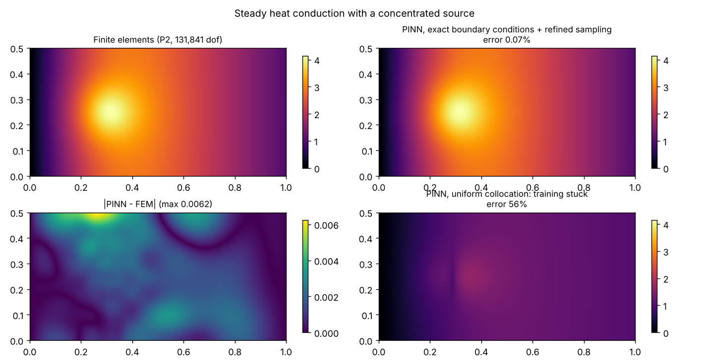
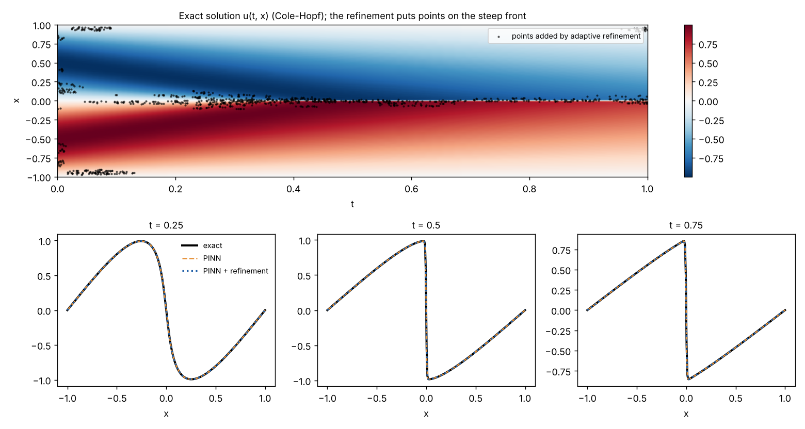
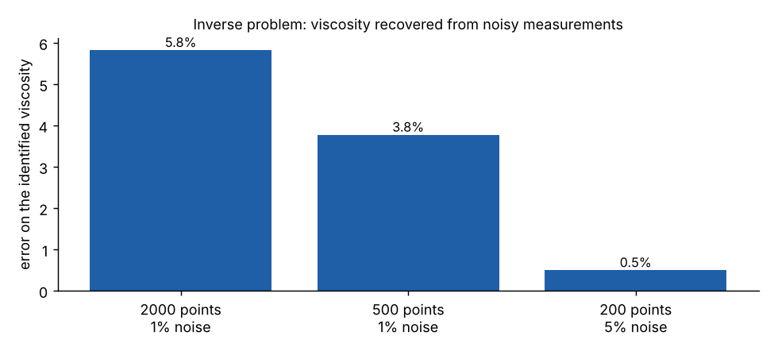
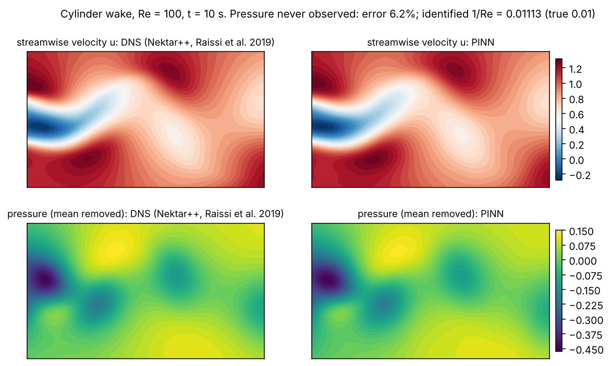

# Physics-informed neural networks for heat conduction and flow, checked against FEM, exact solutions and published data

[](https://github.com/kawtar-bellamine/pinn-mechanics/actions/workflows/tests.yml)

Physics-informed neural networks (PINNs) solve a partial differential equation by training a network whose
derivatives satisfy the equation, without a mesh. They are often presented as a replacement for finite elements;
this project measures where they work, where they fail and what makes the difference, on three problems with a
trusted reference:

- **Steady heat conduction** in a plate with a concentrated heat source, against **P2 finite elements** (scikit-fem,
  131,841 degrees of freedom, converged by refinement).
- **Viscous Burgers flow**, the classic benchmark with a steep front, against the **exact Cole-Hopf solution** and a
  **finite difference solver** and the **reference data published with the original PINN paper** (Raissi,
  Perdikaris and Karniadakis, J. Comput. Phys. 378, 2019), plus an **inverse problem**: recover the viscosity from
  noisy measurements.
- **2D Navier-Stokes, flow past a cylinder at Re = 100**, on the **direct numerical simulation data** published with
  the same paper (spectral/hp elements, Nektar++): from velocity samples only, recover the Reynolds number and the
  pressure field, which is never measured.

The trained models are served by a small FastAPI service (`app/api.py`): any point of the field on request.

## Findings

1. **Well set up, a PINN matches finite elements to 0.07%.** On the heat problem, with the boundary conditions built
   into the network (T = x + x(1 - x) N(x, y), so they hold exactly) and extra collocation points around the
   source, the relative L2 error against FEM is **0.07%** (peak temperature 4.141 against 4.139).

   

2. **Two details decide whether it works at all.** Same network, same training:
   - boundary conditions as a penalty in the loss instead of exact: **30% error**;
   - uniform collocation points instead of points concentrated on the source: **56% error**, the training gets stuck
     on a wrong solution.

   | Heat conduction (one training run each) | Error vs FEM | Training |
   |---|---|---|
   | **Exact boundary conditions + refined sampling** | **0.07%** | 227 s |
   | Boundary conditions as a penalty | 30% | 225 s |
   | Uniform sampling | 56% | 159 s |
   | Finite elements, 33,153 dof | 0.0004% vs the finest mesh | 0.45 s |

3. **On the Burgers front, adaptive refinement divides the error by 3.6.** A PINN reaches 0.75% error over the
   whole space-time domain (maximum local error 0.11, at the front). Adding, three times, the 300 points where the
   residual is the largest (residual-based adaptive refinement) brings it to **0.21%, with a maximum local error of
   0.011**: ten times smaller where it matters. The added points line up on the front.

   

4. **For a forward problem, the classic solver is still faster.** Finite differences on 2,001 points solve Burgers in
   0.3 s with a 0.15% to 0.48% error; the PINN needs 6 minutes of training for 0.21%. FEM solves the heat problem
   in under a second. A trained PINN answers at any point in milliseconds, which only pays off if the same model is
   queried many times or if the problem is an inverse one.

5. **Where PINNs are the right tool: the inverse problem.** Given only noisy measurements of u (no viscosity), the
   network learns the field and the viscosity together. The viscosity is recovered within **0.5% to 5.8%** in the three
   cases tried (2,000 points with 1% noise, 500 points with 1% noise, 200 points with 5% noise), and the field within
   0.3% to 0.5%. A classic solver would need an optimisation loop around it.

   

6. **The published Burgers benchmark is reproduced, and beaten.** Our Cole-Hopf solution matches the authors'
   reference data (`burgers_shock.mat`) to 3 x 10⁻¹² (test). With the paper's own set-up rebuilt in this code
   (boundary conditions as a loss term on 100 points, 10,000 Latin hypercube collocation points, 8 x 20 tanh, L-BFGS),
   the error on the published grid is **0.044%**, against **0.067% reported in the paper**. It costs 19 minutes of
   L-BFGS on a CPU core; the hard-constraint PINN with refinement (finding 3) reaches 0.21% in 6 minutes. Accuracy
   follows the optimiser budget as much as the architecture.

7. **On real flow data, the PINN recovers a pressure field it never saw.** From 5,000 velocity samples drawn in the
   wake (out of 1 million), the network learns the flow and the two coefficients of the Navier-Stokes equations. On a
   full snapshot (t = 10 s): velocity within 1.1% (u) and 3.5% (v), **pressure within 6.2%** (up to a constant, the
   only thing the equations fix), convective coefficient within **0.6%** of 1.

   

   | Cylinder wake, Re = 100 (5,000 velocity samples) | Clean data | 1% noise |
   |---|---|---|
   | λ1 (true 1) | 0.994 (0.6%) | 0.995 (0.5%) |
   | λ2 = 1/Re (true 0.01) | 0.0111 (11%) | 0.0112 (12%) |
   | Velocity u / v, full snapshot | 1.1% / 3.5% | 1.1% / 3.3% |
   | Pressure (never observed) | 6.2% | 6.3% |

8. **The viscosity is the hard part, and the budget shows it.** 1/Re is found within 11% to 12%; the paper reports a
   few percent after an order of magnitude more training on a GPU: viscous terms are small against convection at Re = 100,
   so the data constrain them weakly. 1% noise barely changes anything: the limit is the optimisation (21 minutes of
   CPU, 12,000 Adam steps on mini-batches then 2,000 L-BFGS), not the measurements.

All numbers: [`results/reference_metrics.json`](results/reference_metrics.json),
[`results/ns_metrics.json`](results/ns_metrics.json), [`results/heat_metrics.json`](results/heat_metrics.json), [`results/burgers_metrics.json`](results/burgers_metrics.json).

## Method

- Network: fully connected, tanh, inputs scaled to [-1, 1], float64. Training: Adam then L-BFGS
  ([`pinn/core.py`](pinn/core.py)). Derivatives by automatic differentiation.
- Heat ([`pinn/heat.py`](pinn/heat.py)): -k ΔT = q on [0, 1] x [0, 0.5], T = 0 and T = 1 on the left and right edges,
  insulated top and bottom; Gaussian source (σ = 0.05).
- Burgers ([`pinn/burgers.py`](pinn/burgers.py)): u_t + u u_x = ν u_xx, ν = 0.01/π, u(0, x) = -sin(πx),
  u(t, ±1) = 0, initial and boundary conditions built into the network. Exact solution by the Cole-Hopf transform
  (Gauss-Hermite quadrature, checked by changing the number of nodes); finite differences with a Rusanov flux.

## Run it

```bash
pip install -r requirements.txt
python -m pinn.run_heat        # FEM reference + 3 PINN variants (about 10 min on 2 CPU cores)
python -m pinn.run_burgers     # finite differences, PINN, PINN + refinement, inverse problems (about 20 min)
python -m pinn.reference       # fetches the published data (pinned commit), reproduces the paper's set-up (20 min)
python -m pinn.navier_stokes   # cylinder wake, clean and 1% noise in parallel (about 25 min on 2 cores)
python -m pinn.plots
uvicorn app.api:app            # GET /heat/point?x=0.3&y=0.25, /heat/field, /burgers/profile?t=0.5
pytest -q
```

## Limits

- One training run per configuration: the gaps between configurations are large (0.07% against 30% and 56%), but the
  small differences between the three inverse cases are within run-to-run variation.
- CPU only: the Navier-Stokes inverse problem is trained an order of magnitude less than in the paper; the viscosity error
  (11%) is the price.
- Data from Raissi et al. are fetched from the authors' repository (MIT licence) at a pinned commit, not
  redistributed here.
- Next: structural mechanics (elasticity) with the same protocol: a trusted reference, ablations, and the cost
  compared with the classic solver.

Kawtar Bellamine, 2026.
